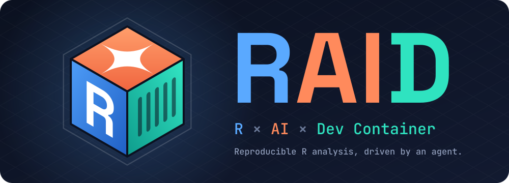

<p align="center">
  
</p>

# RAID Container (R × AI × Dev Container)

Reproducible R analysis workspace powered by Dev Containers. An AI agent running on the host drives R inside the container, while packages are pinned with renv.

- **Image**: `ghcr.io/rocker-org/devcontainer/tidyverse:4.6` (R 4.6, linux/amd64)
- **Packages**: isolated by renv and pinned in `renv.lock`; restored automatically when the container is created
- **Layout**: a ready-to-run pipeline skeleton in `analysis/main/` and `data/{raw,processed}/`
- **CI**: GitHub Actions builds the dev container, checks `renv.lock`, and runs the pipeline (weekly too)

Agent-facing instructions (commands, package workflow, layout rules) live in [`AGENTS.md`](AGENTS.md). `CLAUDE.md` is a symlink to it.

## What You Need

1. **Dev Containers** — VS Code + Dev Containers extension, or the [`devcontainer` CLI](https://github.com/devcontainers/cli)
2. **A container runtime** — Docker Desktop, Colima, etc.
3. **Git**
4. An AI agent on the host — Claude Code, Codex CLI, etc.

## Use as a Template

1. Click **Use this template** on GitHub (or clone and point `origin` at your own repository).
2. Open it in VS Code and **Reopen in Container**, or run `devcontainer up --workspace-folder .` (e.g. macOS + Colima). Packages in `renv.lock` are restored on creation.
3. Put source data in `data/raw/`, open your agent, and hand off the analysis request.

When upgrading R, bump the image tag in `.devcontainer/devcontainer.json` and re-snapshot `renv.lock` inside the new container in the same commit. CI fails if their R versions disagree.

## Running R from the Host

`bin/r` runs `Rscript` inside this repo's dev container, from the repo root:

```zsh
bin/r analysis/main/scripts/run_all.R
bin/r -e 'renv::status()'
```

See [`AGENTS.md`](AGENTS.md) for details.

## System Dependencies

R packages are managed by renv. For system libraries that source builds need, fill in the `apt-packages` feature in `.devcontainer/devcontainer.json`:

```jsonc
"features": {
  "ghcr.io/rocker-org/devcontainer-features/apt-packages:1": {
    "packages": "libxml2-dev,fonts-noto-cjk"
  }
}
```
